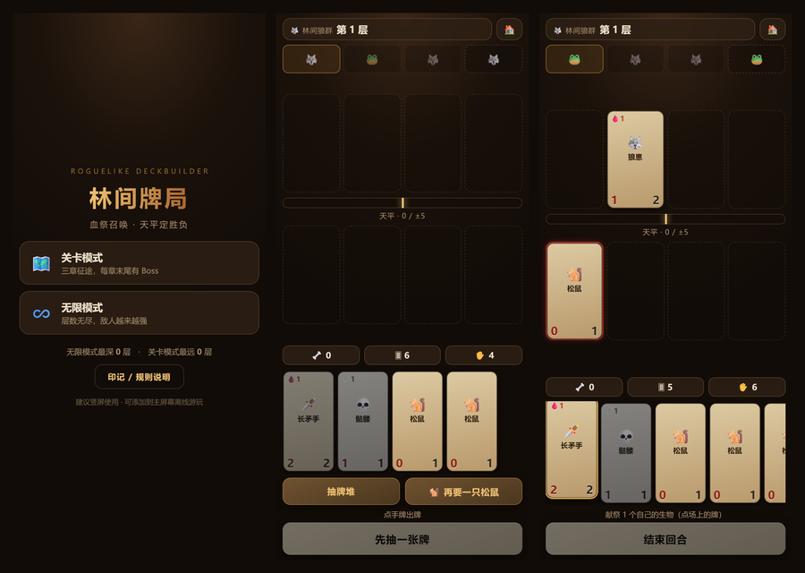

# 🃏 林间牌局

一个**手机优先**的肉鸽卡牌对战游戏，玩法参考 [《邪恶铭刻》(Inscryption)](https://store.steampowered.com/app/1092790/Inscryption/) 的核心循环：**血祭召唤、骨头代币、天平定胜负**。

纯原生 HTML / CSS / JavaScript，**零依赖、零构建**，把仓库挂在 GitHub Pages 上就能当服务器玩。



**在线试玩：<https://qiuye-autumnnight.github.io/inscrypt-like/>**

> 手机上打开链接即可开玩；在浏览器菜单里选「添加到主屏幕」会全屏启动，断网也能玩。
> 想玩别的？回到 [🎮 游戏盒](https://qiuye-autumnnight.github.io/)。

## 核心规则

战场是 **4 条战线**，你一排、敌人一排。生物只会攻击**正对面**那一格：

- 对面有生物 → 打它
- 对面空着 → 伤害直接推进**天平**
- **把天平往自己这边推满 5 格就赢**，被对面推满 5 格就输

所以这不只是"谁的身材大"——**绕开对面的墙**往往比硬碰硬更快。

## 三种费用

| 费用 | 怎么支付 |
| --- | --- |
| 🩸 **血祭** | 点手牌 → 点自己场上的生物献祭掉，献祭几个就够几点血 |
| 🦴 **骨头** | 自己的生物死亡时获得 1 根（被献祭也算），用来召唤亡灵 |
| 免费 | 松鼠、黑山羊这类，直接下场 |

**开局会发 3 张手牌**（2 张来自牌库 + 1 只松鼠），而且**每回合还会白送 1 只松鼠**。

松鼠是 0/1 但完全免费、无限供应——它既是挡刀的路障，也是血祭的祭品。敌人出牌是免费的，如果连路障都要靠抽牌去换，一旦场面被清空就会陷入"抽什么都被打死"的死亡螺旋，所以这里给了稳定的松鼠来源。

**黑山羊**被献祭时提供 3 点血，是典型的"跳费"起手。每回合的抽牌你可以在「抽牌堆」和「再要一只松鼠」之间二选一。

## 七个印记

| 印记 | 效果 |
| --- | --- |
| 🪶 空袭 | 攻击时无视对面的生物，直击天平 |
| 🌵 尖刺 | 被攻击时对攻击者造成 1 点伤害 |
| ⚔️ 双击 | 同时攻击左右相邻的格子 |
| ☠️ 剧毒 | 造成伤害即消灭对方（再大的墙也一张带走） |
| 📜 亡语 | 死亡时抽一张牌 |
| 🌱 生长 | 每次攻击后 +1 攻击 |
| 🪨 石肤 | 每次受到的伤害减 1（至少 1） |

## 敌方预排

战线最上方会**提前显示敌人接下来要出的 4 张牌**——你能看见对手的牌，所以布置是有信息依据的，而不是盲猜。敌人有两种行为：**挡最强**（把牌摆在你攻击力最高的对面）和**抢空位**（专挑你没人的战线打天平）。

## 两种模式

### 🗺️ 关卡模式
三章征途，每章末尾有 Boss（**守林人 → 沼泽之主 → 白骨君王**）。走完三章即通关。

### ♾️ 无限模式
层数无上限，敌人属性随层数增长，每 5 层一个 Boss。看你能撑到第几层，最高纪录存在本机。

两种模式都有 **2 根蜡烛**：输一场灭一根，还要重打那一层；两根都灭就结束这局。篝火节点可以补回一根。

## Roguelike 循环

每层从 3 个岔路里选一个：

| 节点 | 作用 |
| --- | --- |
| ⚔️ 遭遇战 | 普通战斗，胜利后三选一加牌 |
| 💀 精英 | 强敌，奖励是**稀有牌** |
| 🎁 拾遗 | 不用战斗，直接三选一加牌 |
| 🔥 淬炼 | 给一张牌 +1 攻击 / +1 生命 / 加一个印记 |
| ✂️ 遗忘 | 从牌组里移除一张牌（精简牌组很重要） |
| 🕯️ 篝火 | 恢复一根蜡烛 |

## 难度设计

这套数值是反复调过的，几条原则：

- **Boss 靠"血厚"而不是"攻高"制造压力**。攻高会一回合把玩家打穿，血厚只是难啃，还能靠阻挡和周旋。第一章 Boss 是 3/4 的灰狼，不是 5/9 的灰熊。
- **Boss 卡池里绝不出现「空袭」**。空袭无视阻挡直击天平，一个 6/7 带空袭的 Boss 每回合白掉 6 点，玩家没有任何解法。
- **敌人有站位上限**：第 1-4 层最多 2 张、5-9 层 3 张、之后才铺满 4 格。敌人出牌免费而玩家要付费，不设上限会形成节奏压制。
- **敌人牌池按层数解锁**：第 1 层只会遇到最弱的牌池，不会开局就撞上后期的狼群首领。
- **玩家的牌池刻意强于敌人**：长矛手（1 血 2/2）、熊崽（2 血 3/3）、女猎手（2 血 2/2 空袭）是玩家专属，敌人不会拿到。

## 操作

| 操作 | 说明 |
| --- | --- |
| 点手牌 | 选中；需要血祭时进入献祭状态 |
| 点自己的生物 | 献祭（仅献祭状态下） |
| 点空格子 | 放下选中的牌 |
| 点场上的牌 | 查看详情与印记说明 |
| 点「抽牌堆 / 松鼠堆」 | 每回合开始二选一 |
| 空格 / `Enter` | 结束回合（弹窗时等于点按钮） |
| `D` / `S` | 抽牌堆 / 松鼠堆 |

## 特性

- 🎴 **纯 DOM 卡牌**：卡面全是文字和数字，用 DOM 而不是 Canvas，文字清晰、可随时改样式
- 💾 **进度自动保存**：地图处自动存档，刷新或切后台回来能「继续上次的牌局」
- 📴 **离线可用**：Service Worker 缓存全部资源
- 🏆 **双模式纪录**：无限模式最深层数 + 关卡模式最远层数
- 🔊 无音频依赖，纯视觉反馈（受击抖动、突刺、卡牌碎裂动画）

## 本地运行

用到了 Service Worker，请用 HTTP 方式打开，不要直接双击 `index.html`：

```bash
python -m http.server 8000
```

然后访问 <http://localhost:8000>。

## 文件结构

```
.
├── index.html              # 三个界面（标题 / 地图 / 战斗）
├── styles.css              # 样式与响应式布局
├── game.js                 # 卡牌数据、战斗状态机、地图与存档
├── sw.js                   # Service Worker（离线缓存）
├── manifest.webmanifest    # PWA 清单
├── icons/                  # 各尺寸图标
├── screenshot.png          # README 预览图
└── .nojekyll               # 跳过 Jekyll
```

## 实现要点

- **确定性可测**：整套逻辑只依赖一个 `Math.random`，测试时把它换成可控序列，洗牌 / 敌人选择 / AI 落位全部确定化，于是能对每一次攻击的数值做精确断言
- **先加过载式的顺序问题**：伤害结算必须"玩家先攻 → 判胜 → 敌人攻 → 判负"，中途任何一次天平到顶都要立刻结束，否则会出现双方同时打满的歧义
- **天平要夹在 ±5**：一回合内多只生物同时命中时总和可能超过 5，早期版本会显示成 `-8`，读起来很困惑
- **敌人"挡最强"要忽略 0 攻击生物**：否则一只松鼠就能把敌人的挡位吸走，AI 显得很蠢
- 这是**致敬玩法的原创实现**，没有使用《邪恶铭刻》的任何素材、代码或名称

## License

[MIT](./LICENSE)
